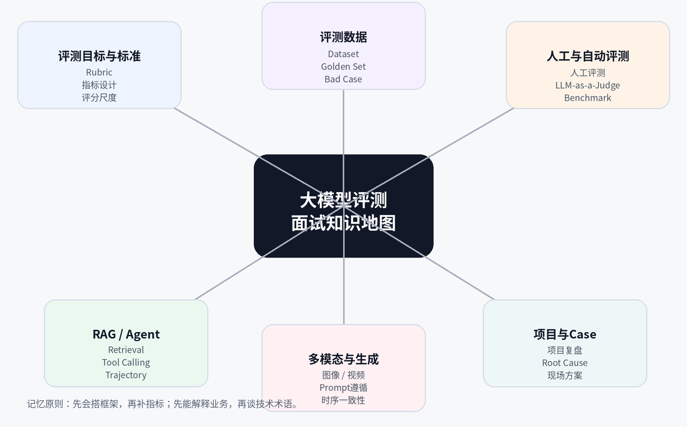
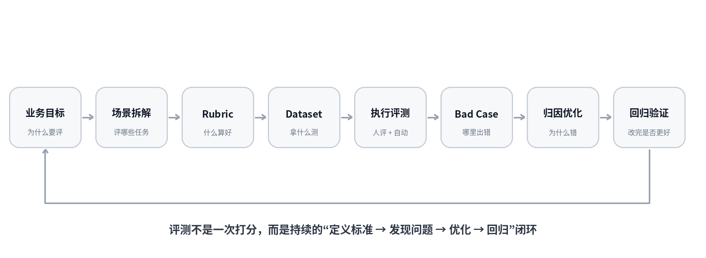
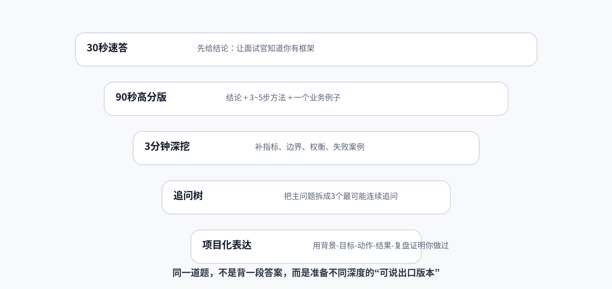
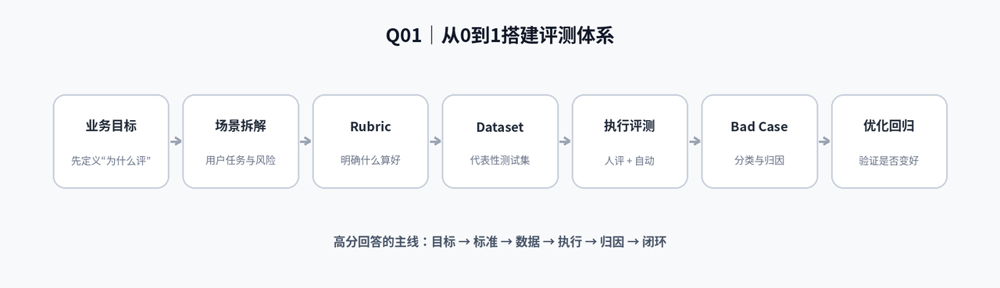
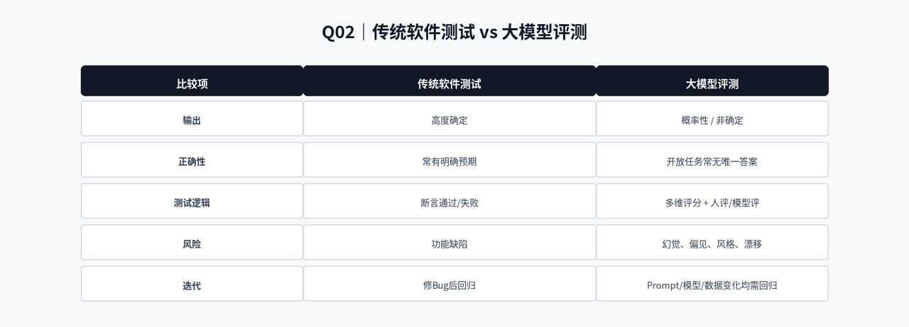

# 大模型评测面试核心36题 · 总目录与使用指南

2026 大模型评测面试核心36题

总目录 · 使用指南 · 冲刺路线

36 道核心题 × 108 个连续追问 × 30 秒速答 × 90 秒高分回答 × 深度拆解

  

版本 2026.08 ｜ 面向：大模型评测 / AI训练师 / AI数据策略 / AI产品 / 多模态评测相关岗位

---

## 使用这套题库之前

这不是“题越多越好”的八股合集，而是一套围绕真实大模型评测工作方法组织的面试作战手册。核心目标只有两个：

- 面试现场能快速搭出结构，不因为紧张只剩下一堆术语。
- 面对连续追问，能从业务目标、评测标准、数据、执行、Bad Case 和迭代闭环继续往下讲。

> **核心原则**：不要把 36 题当成 36 段独立答案。真正需要掌握的是一套可以迁移到陌生 Case 的评测框架。

## 这套题库适合哪些岗位

| 目标岗位 | 这套题库最值得看的部分 |
| :--- | :--- |
| 大模型评测 / AI测试 | 重点掌握 Rubric、Dataset、Judge、Benchmark、Bad Case、RAG/Agent 评测。 |
| AI训练师 / 数据策略 | 重点掌握数据质量、评测集、Golden Set、人评一致性、反馈闭环。 |
| AI产品经理 / Agent产品经理 | 重点掌握业务目标拆解、评测指标、线上/离线评测、体验与业务指标。 |
| 多模态 / AIGC评测 | 重点掌握图像视频的 Prompt 遵循、一致性、美学、时序、物理合理性。 |
| AI数据项目 / 项目管理 | 重点掌握 SOP、标注口径、质检、仲裁、交付、复盘和风险控制。 |

## 一张图看懂：完整评测闭环

  

图01 ｜ 大模型评测完整闭环

> **面试怎么用**：如果遇到任何“怎么评”“怎么设计评测体系”“怎么分析 Bad Case”的开放题，优先从这条闭环开始回答，再根据业务类型补具体指标。

## 每一道题，为什么要准备三种回答深度

  

图02 ｜ 同一道题的五层准备法

> **推荐使用方式**：30 秒速答解决“先把话说清楚”；90 秒版解决“结构完整”；3 分钟深挖解决“专业度”；追问树解决“连续拷打”；项目化表达解决“你到底做没做过”。

---

## Q01｜如果让你从 0 到 1 设计一套大模型评测体系，你会怎么做？

> **核心关键词**：Eval-driven development ｜ Success Criteria ｜ Scenario Taxonomy ｜ Rubric ｜ Dataset ｜ Golden Set ｜ Human Eval ｜ LLM-as-a-Judge ｜ Bad Case ｜ Regression

  

图03 ｜ 如果让你从 0 到 1 设计一套大模型评测体系

### 01｜面试官为什么问这道题

这是大模型评测岗位最典型的综合题。面试官不是想听你背出几个指标，而是在判断你是否具备“从业务问题出发，建立标准、数据和闭环”的完整能力。高分候选人通常先讲目标与场景，再讲 Rubric 和数据，最后讲执行、Bad Case 和回归；低分候选人往往一上来就堆 BLEU、ROUGE、准确率。

### 02｜一句话核心结论

**一句话**：我会先定义业务成功标准，再拆场景和风险，建立 Rubric 与评测集，用人工和自动评测组合执行，最后通过 Bad Case 归因和回归评测形成持续迭代闭环。

### 03｜30 秒面试速答版

**可直接说**：如果让我从 0 到 1 设计，我不会先选指标，而是先确认业务目标和用户场景。然后把场景拆成可评任务，定义准确性、相关性、完整性、安全性等 Rubric，再构建代表真实流量和长尾风险的评测集。执行层会根据任务选择规则指标、人评或 LLM Judge，并保留人工校准。最后把结果沉淀成 Bad Case 分类，定位是模型、Prompt、数据还是系统问题，优化后做回归评测，形成闭环。

### 04｜90 秒高分回答版

**推荐主答**：我通常会分六步。

1. **明确评测目的**：例如是在做模型选型、版本上线门禁，还是定位线上 Bad Case，因为目的不同，评测集和指标都会不同。
2. **拆业务场景**：把用户真实任务、关键路径、高风险场景和长尾输入列出来。
3. **定义“什么算好”**：用 Rubric 把准确性、相关性、完整性、忠实性、安全性等维度写成可执行标准。
4. **构建 Dataset**：既包含真实流量，也包含 Golden Case、困难样本和风险样本。
5. **选择评测方法**：能确定性判断的用规则或代码，有参考答案的用 Exact Match/F1 等，主观生成用人评或 LLM-as-a-Judge，并用人工标注做校准。
6. **分析结果**：不只看总分，而是做分场景切片和 Bad Case 归因；优化 Prompt、模型、RAG 或数据后做回归，保证关键能力没有退化。最终评测应该服务于一个决策，比如是否上线、选哪个模型、优先优化哪个问题。

### 05｜3 分钟深度回答版

真正的“评测体系”不是一张指标表，而是一套决策系统。它至少包含五类对象：评什么（目标和任务）、什么算好（标准）、拿什么测（数据）、怎么判（评测器）、结果如何影响行动（阈值与闭环）。

1. **定义 Decision Question**：比如“模型 A 是否可以替换模型 B”与“客服机器人能否上线”完全不同——前者适合 Pairwise 和成本/速度权衡，后者还要加入安全、拒答、业务合规与线上体验。
2. **做 Scenario Taxonomy**：把流量按任务、用户、难度、风险拆层；否则平均分会掩盖关键场景退化。
3. **定义 Rubric 与 Metric**：Rubric 解决语义标准，Metric 负责把判断转成数字。
4. **构建数据集**：注意真实分布和风险覆盖之间的平衡——只采线上流量会低估长尾风险，只造困难题又会脱离真实业务。
5. **建立执行和质量控制**：包括评测员培训、LLM Judge 校准、重复采样、版本记录。
6. **做结果解释**：总分、切片、置信度、成本、延迟、失败类型一起看。最后把 Bad Case 转成产品/模型优化任务，并把历史失败加入回归集。

### 06｜完整知识拆解

> **表达要求**：不要只报术语，要说明它为什么影响最终决策，以及出现异常时下一步怎么处理。

| 环节 | 关键要点 |
| :--- | :--- |
| 6.1｜明确评测目的 | 选型 / 上线 / 回归 / 排障 |
| 6.2｜拆业务场景 | 主路径 + 长尾 + 高风险 |
| 6.3｜定义 Rubric | 什么算好、什么算坏 |
| 6.4｜构建 Dataset | 真实流量 + Golden + 难例 |
| 6.5｜选择 Evaluator | 规则 / 参考答案 / 人评 / Judge |
| 6.6｜执行与切片 | 按场景、难度、用户分层 |
| 6.7｜Bad Case 归因 | 模型 / Prompt / RAG / 数据 / 工程 |
| 6.8｜优化后回归 | 验证提升且不引入新退化 |

### 07｜真实业务案例

以“企业知识库客服”为例：目标不是追求一个抽象的模型高分，而是“用户能快速得到正确、可追溯的公司政策答案”。

- **任务拆解**：政策查询、流程指引、权限问题、未知问题拒答四类。
- **Rubric**：至少包含答案正确性、引用忠实性、完整性、拒答正确性、表达可读性。
- **评测集**：真实工单抽样，并补充旧政策、冲突文档、权限不足等高风险 Case。
- **上线判断**：按任务切片看结果；如果总分上升但拒答正确率下降，就不能上线。

### 08｜面试官追问

**追问①**：如果只有两天时间，你怎么做最小可用评测？

**参考回答**：先抓最关键的业务决策和 Top 场景，不追求全面。选 50–100 条高价值样本，优先覆盖主路径和高风险；写一个最小 Rubric；能规则化的先自动，主观部分双人快速人评。目标是先建立可重复基线，而不是两天做出“完美 Benchmark”。

**追问②**：指标很多时怎么定权重？

**参考回答**：权重应来自业务风险和用户价值，不应凭感觉平均分。可以先设“硬门槛 + 加权质量分”：例如安全和事实错误是 Gate，任何一项低于阈值都不能上线；在通过 Gate 后，再对相关性、完整性、风格做加权。

**压力追问③**：总体分提升了 5%，为什么你仍然可能不同意上线？

**参考回答**：因为平均分可能掩盖关键场景退化。我要看高风险切片、严重错误率、用户主路径、成本和延迟。如果整体提升来自低价值场景，而合规或核心任务退化，即使平均分更高也不应上线。

### 09｜常见低分回答

**低分示范 / 为什么低分**：“我会先选准确率、BLEU、ROUGE，然后跑一下模型看分数。”问题在于没有业务目标、场景和标准，指标和决策脱节；即使得到一个数字，也无法回答“能不能上线”和“该优化哪里”。

### 10｜高分关键词

- **Eval-driven development**：评测驱动开发
- **Success Criteria**：成功标准
- **Scenario Taxonomy**：场景分类体系
- **Rubric**：评分量规（评分标准）
- **Dataset**：数据集
- **Golden Set**：黄金标准集
- **Human Eval**：人工评测
- **LLM-as-a-Judge**：大模型作为裁判
- **Bad Case**：失败案例
- **Regression**：回归测试

### 11｜面试前 10 秒速记

> **只记这一句**：目标 → 场景 → 标准 → 数据 → 评法 → 切片 → Bad Case → 回归。

## Q02｜你认为“大模型评测”到底是在评什么？和传统软件测试有什么区别？

> **核心关键词**：Nondeterminism ｜ Task-specific Eval ｜ Human Judgment ｜ System Eval ｜ Regression ｜ Reliability ｜ Safety ｜ Production Distribution

  

图04 ｜ 传统软件测试 vs 大模型评测

### 01｜面试官为什么问这道题

这题看似基础，实际上考察候选人是否理解生成式 AI 的核心特征：输出具有概率性，很多任务没有唯一标准答案，系统质量还受到 Prompt、检索、工具、上下文和模型版本共同影响。

### 02｜一句话核心结论

**一句话**：传统测试更多验证“系统是否按确定规则运行”，大模型评测则是在不确定输出下，用结构化标准判断“这个 AI 系统是否持续满足用户和业务期望”。

### 03｜30 秒面试速答版

**可直接说**：我理解大模型评测评的不只是模型参数，而是整个 AI 系统在真实任务里的有效性、可靠性和风险。传统软件测试通常可以写明确断言：输入 A 就应该得到 B；但大模型同一输入可能有多个合理答案，因此需要 Rubric、多维指标、人评或模型评。除此之外，大模型还要评幻觉、指令遵循、风格、安全、鲁棒性，以及 RAG 和 Agent 的过程行为。核心区别是：传统测试主要验证确定性功能，大模型评测是在概率系统里定义“什么算足够好”。

### 04｜90 秒高分回答版

**推荐主答**：我会从三个层面区分。

1. **输出性质不同**：传统软件逻辑相对确定，测试可以围绕预期输出做 Pass/Fail；生成模型具有非确定性，同一个输入可能产生多个正确答案，所以需要 Pointwise、Pairwise、Rubric 和统计视角。
2. **质量维度不同**：除了功能正确，大模型还要关注相关性、事实性、完整性、指令遵循、安全、稳定性、成本和延迟。
3. **故障边界不同**：传统 Bug 通常能定位到代码路径，而 AI 系统的 Bad Case 可能来自模型、Prompt、上下文、RAG、数据分布、工具调用或模型升级。

所以大模型评测更像“持续质量度量 + 决策体系”，而不是上线前一次测试。

### 05｜3 分钟深度回答版

大模型评测的对象可以分成四层：

| 层级 | 关注点 |
| :--- | :--- |
| 模型能力 | 基础能力上限 |
| 任务效果 | 当前业务任务是否完成 |
| 系统过程 | RAG、Agent、工具调用、Guardrail 等链路是否可靠 |
| 业务结果 | 用户成功率、投诉、转人工率、成本 |

面试时如果只说“评准确率”，会显得仍停留在传统监督学习思维。

传统测试当然也有非确定系统、性能测试和统计测试，所以不要说“传统测试一定完全确定”。更准确的说法是：LLM 应用把非确定性、开放式输出和语义评价变成了常态，因此测试设计更依赖数据分布、评分标准、人工判断和持续回归。

### 06｜完整知识拆解

> **表达要求**：不要只报术语，要说明它为什么影响最终决策，以及出现异常时下一步怎么处理。

| 环节 | 关键要点 |
| :---: | :--- |
| 6.1｜输出 | 确定断言 vs 概率生成 |
| 6.2｜标准 | 唯一答案 vs 多个合理答案 |
| 6.3｜指标 | 功能 Pass/Fail vs 多维 Rubric |
| 6.4｜故障 | 代码 Bug vs 模型 / Prompt / RAG / 数据链路 |
| 6.5｜方法 | 单次测试 vs 数据集上的统计评估 |
| 6.6｜生命周期 | 上线前 QA vs 持续 Evals 与回归 |

### 07｜真实业务案例

例如传统“重置密码”页面：点击按钮是否发送邮件，可以明确断言。但如果是 AI 客服回答“我忘记密码怎么办”，正确答案可以有不同表达；你既要看步骤是否正确，也要看有没有捏造政策、是否遗漏安全提醒、是否过度啰嗦，甚至用户追问时能否保持上下文一致。

### 08｜面试官追问

**追问①**：那大模型评测和机器学习模型评估有什么区别？

**参考回答**：传统 ML 评估常围绕固定标签和明确 ground truth，例如 Accuracy、AUC、F1；大模型更常面对开放式生成、长文本和多轮交互，因此需要语义 Rubric、人类偏好、Judge、过程评测和业务指标。

**追问②**：是不是大模型就不能做确定性测试？

**参考回答**：不是。能确定性验证的部分反而应该尽量确定性，例如 JSON 格式、关键词、工具参数、引用 ID、SQL 执行结果。原则是“能代码判就不要主观判”，把主观评测留给真正需要语义判断的部分。

**压力追问③**：一个大模型产品完全不做人工评测可以吗？

**参考回答**：早期和高风险场景通常不建议。自动评测要有可信基准，Judge 也需要人工标注做校准。成熟后可以扩大自动化比例，但仍需要定期人工抽检和处理新型 Bad Case。

### 09｜常见低分回答

> **低分示范**：“传统测试是测代码，大模型评测是测模型。”
>
> **为什么低分**：这个回答过于粗糙，因为真实产品评的是整个 AI 系统，不只是底座模型；而且传统测试也不仅仅是代码功能。

### 10｜高分关键词

- **Nondeterminism**：非确定性
- **Task-specific Eval**：任务特定评测
- **Human Judgment**：人工判断
- **System Eval**：系统级评测
- **Regression**：回归测试
- **Reliability**：可靠性
- **Safety**：安全性
- **Production Distribution**：生产流量分布

### 11｜面试前 10 秒速记

> **只记这一句**：传统测试问“是否按预期运行”；大模型评测问“在不确定输出下，是否持续满足业务和用户标准”。
